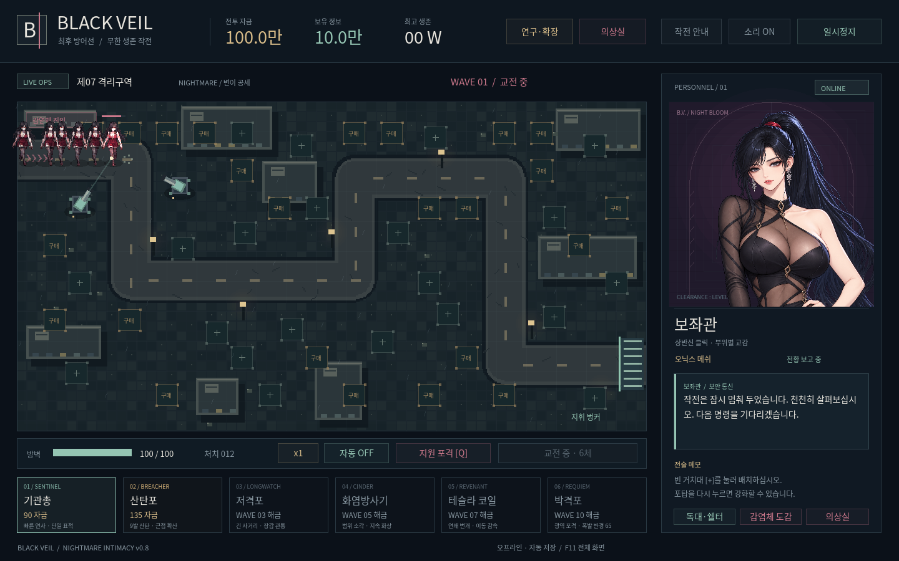
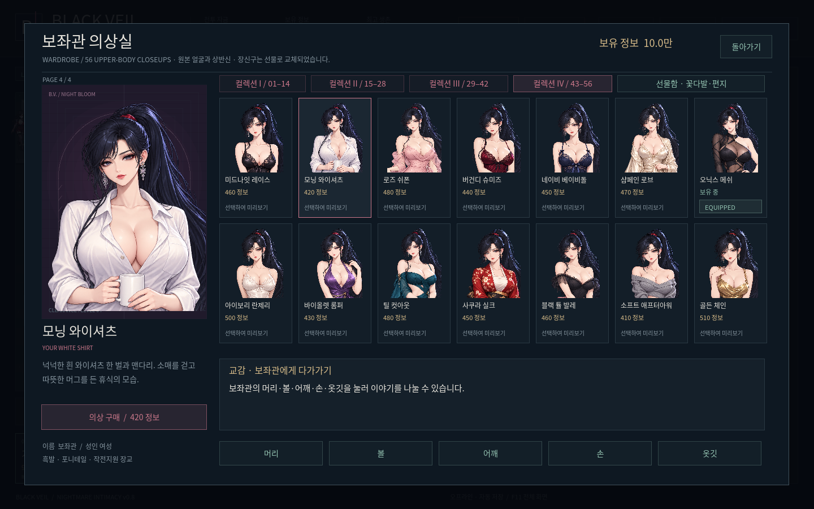
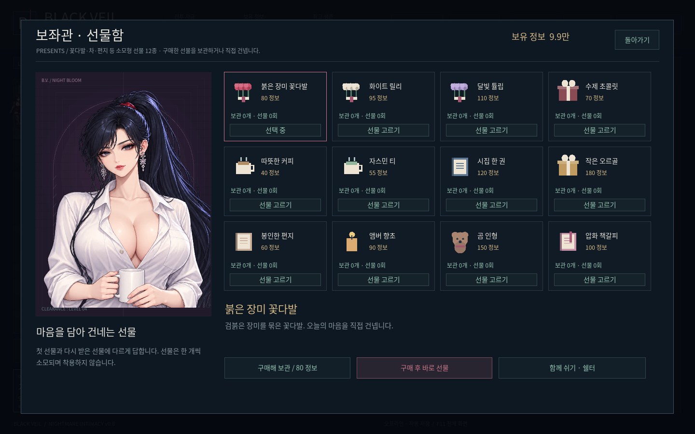
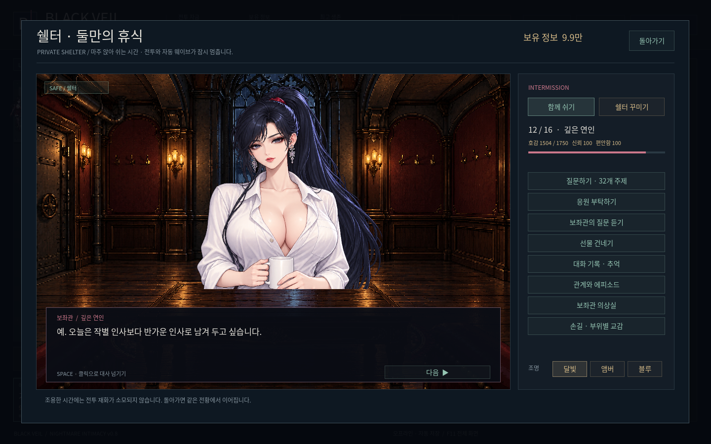
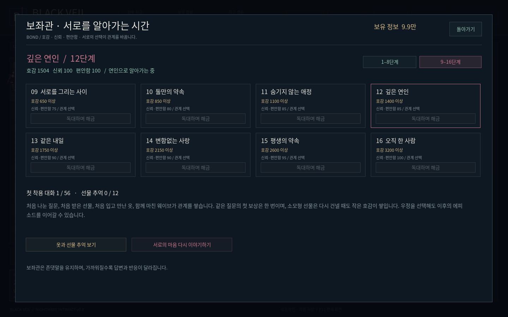
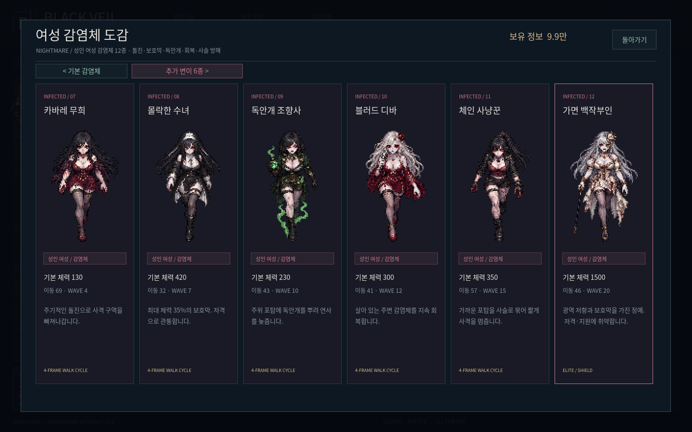

# BLACK VEIL v0.8 · NIGHTMARE INTIMACY

**[Windows ZIP 직접 다운로드](https://github.com/selecter1302-cloud/-/raw/refs/heads/blackveil-download-v0.8.0/BlackVeil-Windows.zip)**

압축을 풀고 BlackVeil.exe를 실행하세요. Windows 10/11 x64용 오프라인 게임입니다.

- 56벌 전부 상반신 클로즈업. 원본을 288픽셀로 줄이던 중간 단계를 제거하고 원본 얼굴을 그대로 표시합니다.
- 호감도 16단계. 상호 질문 각각 32개, 연인 에피소드·가까운 거리·포옹·입맞춤을 묻는 대사를 추가했습니다. 준비된 NPC 대사 총 866개입니다.
- 머리·볼·어깨·손·옷깃 터치와 각 부위의 16단계 반응을 추가했습니다.
- 장신구 시스템을 제거하고 꽃다발·커피·편지 등 소모형 선물 12종으로 교체했습니다. 이전 구매분은 한 번 환급됩니다.
- 여성 감염체 12종. 돌진·보호막·회복·독안개·포탑 속박과 강화된 후반 공세를 추가했습니다.
- 무한 강화·연구 24종·배치칸 확장·가격 직접 설정·10배속·쉘터 꾸미기를 유지합니다.

[24초 실제 게임 영상](https://github.com/selecter1302-cloud/-/raw/refs/heads/blackveil-download-v0.8.0/preview/Advisor-Preview-v0.8.mp4) · [56벌 개별 클로즈업](preview/portraits)

저장은 기존 `%APPDATA%\BlackVeil\black_veil.json`을 이어갑니다. 이전 빌드의 진행 중 전투는 첫 전환 때 일시정지합니다. 포탑과 연구를 정비한 뒤 계속하기를 눌러 주세요.

실제 화면 조작·저장 이전·적 특수 능력·최종 EXE 내장 게임과 다운로드 무결성을 확인합니다. Windows 실기기 실행은 이 Linux 환경에서 미확인입니다.

[변경·난이도·저장 이전 상세](REDEVELOPMENT.md) · [SHA-256](SHA256SUMS.txt)
