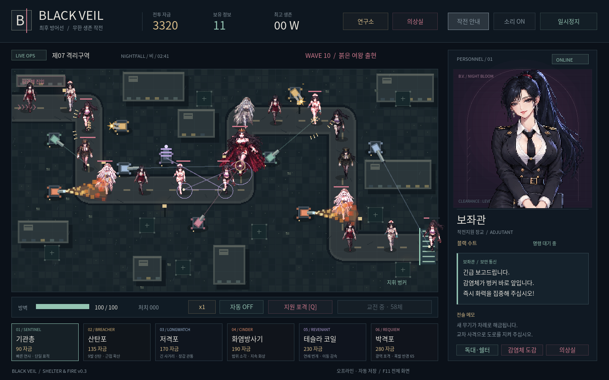
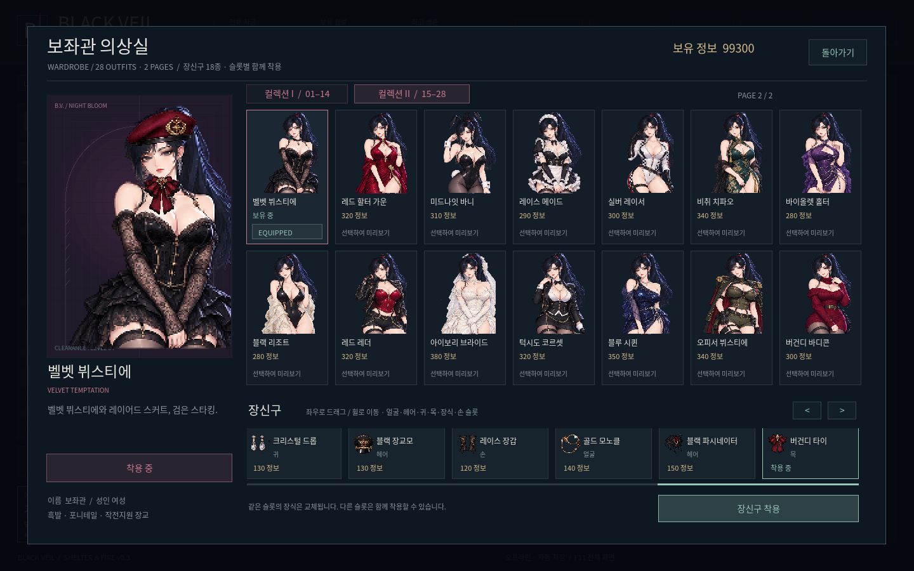
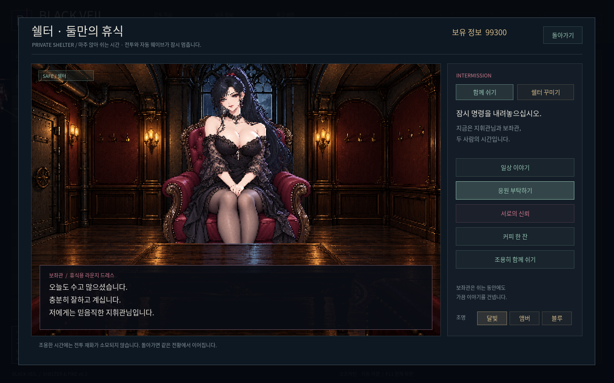
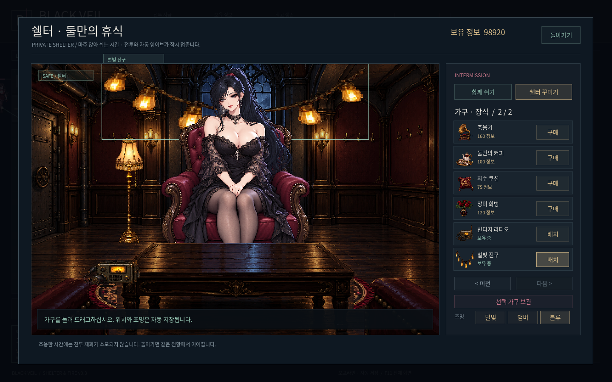

# BLACK VEIL — SHELTER & FIRE v0.3

[Windows ZIP 다운로드](BlackVeil-Windows.zip?raw=1)

압축 해제 후 BlackVeil.exe를 실행하세요. 기존 자동 저장·의상·정보·연구는 유지됩니다.

- 화염방사기: 실제 전방 부채꼴 피해, 불꽃·화상·연기와 분사음.
- 샷건: 9발 산탄 판정, 거리별 피해, 총구 섬광·반동·탄피와 별도 발사음.
- 1~5배속, 적 위치·위험도에 따른 상시 보고와 휴식 중 칭찬·격려·신뢰 대사.
- 추가 의상 14종, 총 28종의 두 페이지 의상실.
- 장신구 12종 추가, 좌우 드래그와 슬롯별 동시 착용.
- 의자에 마주 앉아 대화하는 독대 쉘터. 일상·응원·신뢰·커피 대화.
- 쉘터 가구·장식 12종 구매, 실제 드래그 배치, 보관, 조명과 자동 저장.

전투·저장·대사 검증 189개와 실제 화면·마우스 입력 검증 48개 통과. 그래픽 검증은 Linux에서 수행했으며 Windows 실기기 실행은 미확인입니다.

