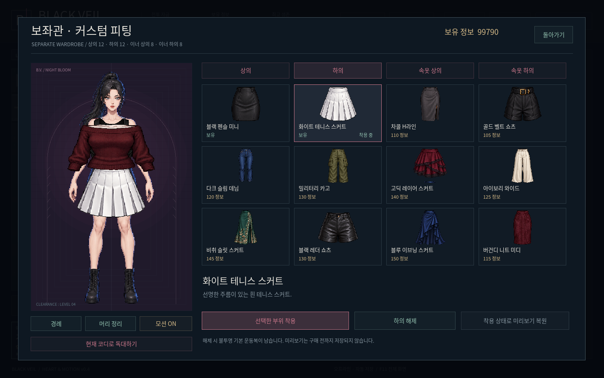
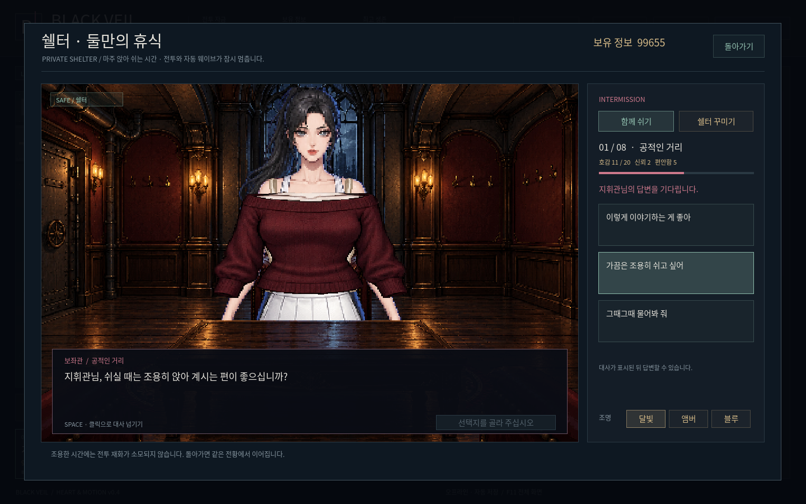

# BLACK VEIL · HEART & MOTION v0.4

**[Windows ZIP 바로 다운로드](https://github.com/selecter1302-cloud/-/raw/refs/heads/blackveil-download-v0.4.0/BlackVeil-Windows.zip)**

압축 해제 후 `BlackVeil/BlackVeil.exe`를 실행하세요. Windows 10/11 x64용이며 설치나 인터넷 연결은 필요 없습니다.

- 보좌관: 22개 본의 실제 2D 리깅, 간헐적 모션·표정. 전투와 쉘터에 현재 코디를 표시합니다.
- 의상: 기존 세트 28벌 + 별도 구매·착용·해제하는 부위별 40종. 해제하면 불투명 기본 운동복이 남습니다.
- 관계: 호감도 8단계, 신뢰·편안함, 관계 선택, 질문 24종·보좌관 질문 24종과 3지 답변, 새 보좌관 대사 544개.
- 반응과 기록: 의상별 첫 독대, 장신구별 감사, 대화 기록과 관계 에피소드, 진행 중 선택지·대사 저장 복원.
- 기존 전투: 화염 분사·9발 산탄·5배속·여성 감염체·무한 웨이브·재화·해금·쉘터 꾸미기.

전투·관계·저장·리깅·실제 화면과 입력·소리 검사 484개를 통과했습니다. Windows PE x64 파일과 내장 프로젝트 시작, ZIP CRC를 검증했습니다. Windows 실기기 실행은 아직 미확인입니다.

압축 파일 안의 README.md에 전체 조작과 콘텐츠 안내가 있습니다. SHA256SUMS.txt에는 실행 파일과 ZIP의 SHA-256이 있습니다.
