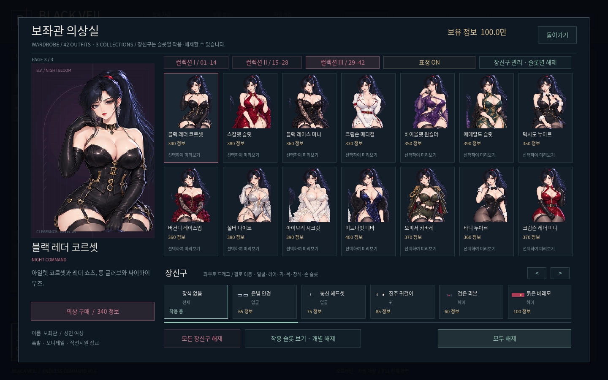
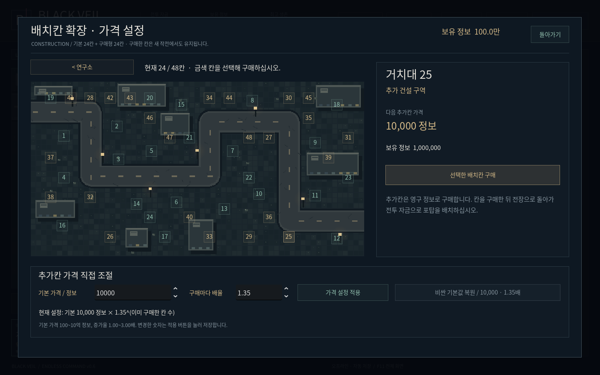
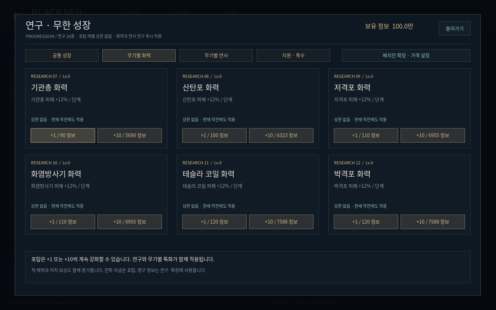

# BLACK VEIL v0.6 · ENDLESS COMMAND

[Windows ZIP 직접 다운로드](https://github.com/selecter1302-cloud/-/raw/refs/heads/blackveil-download-v0.6.0/BlackVeil-Windows.zip)

압축을 풀고 BlackVeil.exe를 실행하세요. Windows 10/11 x64용 오프라인 게임입니다.

- 원래 보좌관 얼굴 느낌 복원, 기본 정장·컬렉션 III의 풍만한 체형과 드러나는 의상 원화 재제작.
- 어긋난 눈 덧그리기 제거. 기본 정장에 눈 감은 원화 프레임 적용.
- 부위별 커스텀 제거, 이전 구매 비용은 정보로 한 번 환급.
- 무기 6종 무한 레벨업, +1/+10 강화, 연구 24종과 무기별 화력·공격속도 연구.
- 기본 배치칸 24개와 영구 구매 24개. 기본 10,000 정보, 구매마다 1.35배.
- 연구·확장에서 추가칸 기본 가격과 증가율 직접 설정·저장.
- 적 체력과 전투 보상 성장 재조정. 추가 자금 없는 50웨이브 성장 검증.

[실제 게임의 10초 깜박임 영상](https://github.com/selecter1302-cloud/-/raw/refs/heads/blackveil-download-v0.6.0/preview/Advisor-Blink-v0.6.mp4)

자세한 변경과 저장 이전은 [REDEVELOPMENT.md](REDEVELOPMENT.md)를 확인하세요. 기존 저장을 이어갑니다. Windows 실기기 실행은 아직 미확인입니다.
