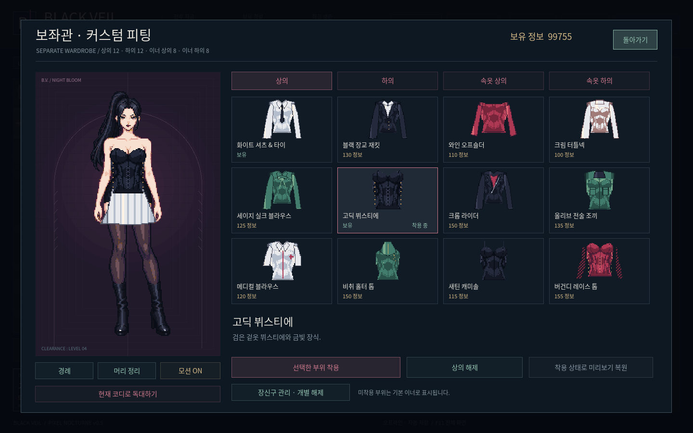
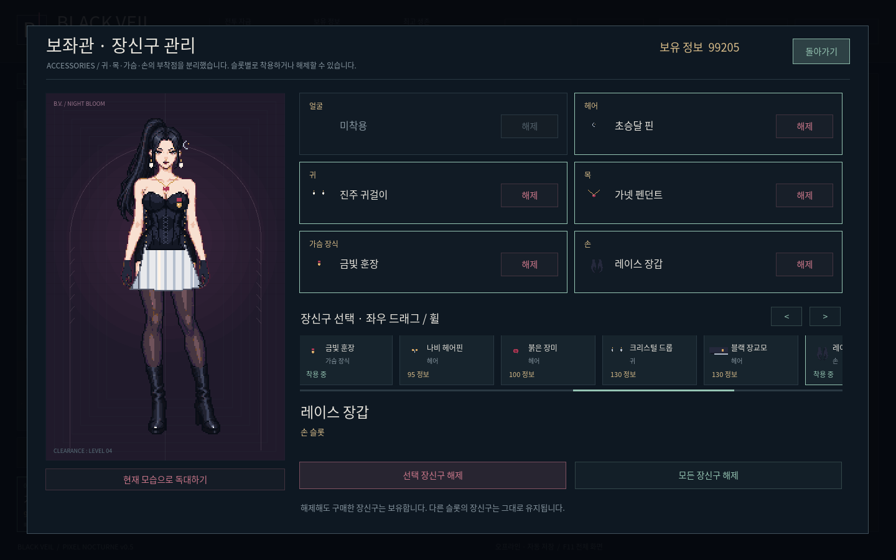

# BLACK VEIL · PIXEL NOCTURNE v0.5

**[Windows ZIP 바로 다운로드 · 40.6 MiB](https://github.com/selecter1302-cloud/-/raw/refs/heads/blackveil-download-v0.5.0/BlackVeil-Windows.zip)**

압축을 풀고 `BlackVeil/BlackVeil.exe`를 실행하세요. Windows 10/11 x64용이며 별도 설치와 인터넷 연결은 필요 없습니다.

- 전신 물결형 변형을 제거하고 2D 도트 분리 파츠와 짧은 프레임 동작으로 재구성했습니다. 3D 모델은 아닙니다.
- 보좌관을 128×256 논리 캔버스와 고정 팔레트로 정리하고, 부위별 의상 40종을 공통 몸 기준으로 다시 합성했습니다.
- 장신구 크기와 귀·목·가슴·손 부착점을 수정했습니다. 관리 화면에서 슬롯별 해제와 전체 해제를 할 수 있고, 구매한 소유권과 무료 재착용을 유지합니다.
- 더 과감한 고딕 패션의 컬렉션 III 14벌을 추가했습니다. 코르셋·슬릿 가운·레이스 미니·메디컬 미니·원숄더·무대복·롱 글러브·싸이하이 등으로 구성하며, 세트 의상은 총 42벌입니다.
- 호감도 8단계, 상호 질문과 선택지, 선물·첫 착용 반응·대화 기록·쉘터 꾸미기와 기존 전투를 유지합니다. 새 의상 반응을 포함한 보좌관 상호 대사는 572개입니다.
- 이전 저장의 재화·연구·해금·전투·관계·대화·쉘터를 이어갑니다.

[재개발 기준과 확인 항목](REDEVELOPMENT.md)

[착용 화면](preview/jewelry_equipped.png) · [전체 해제 화면](preview/jewelry_removed.png) · [독대 화면](preview/shelter.png) · [네이티브 의상 아틀라스](preview/native-outfits.png)

전투·저장·관계·픽셀·파츠·장신구·실제 화면과 입력·소리 검사 628개를 통과했습니다. 실행 파일에 내장된 게임에서도 재개발 화면 검사 28개를 통과했습니다. Windows PE x64, 내장 프로젝트 시작과 ZIP CRC를 확인했습니다. 그래픽 실행 검사는 Linux에서 수행했으며 Windows 실기기 실행은 아직 미확인입니다.

압축 안의 README.md와 실행안내.txt에 전체 안내가 있습니다. SHA256SUMS.txt는 실행 파일과 ZIP의 SHA-256입니다.
