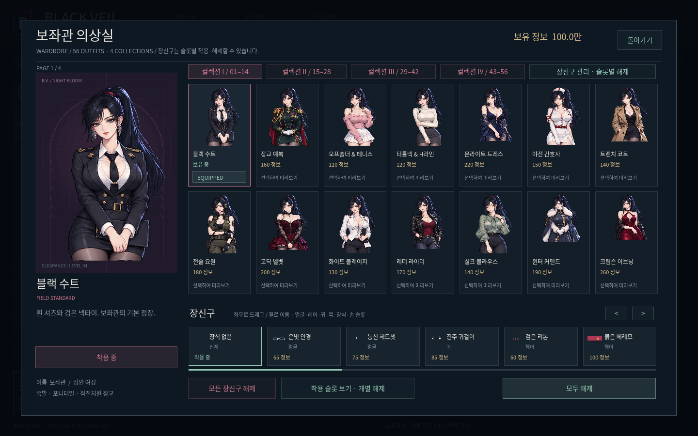
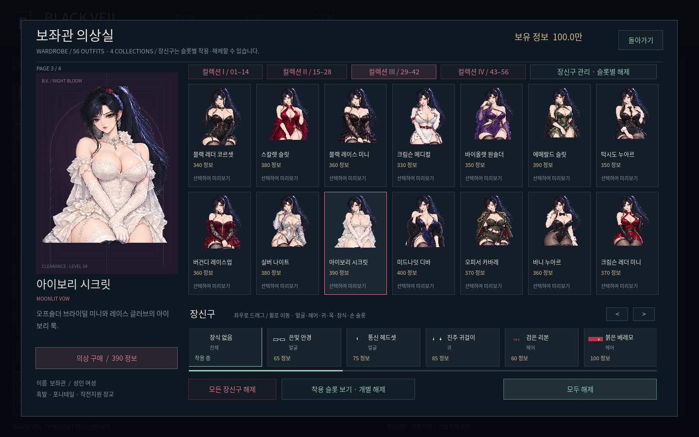
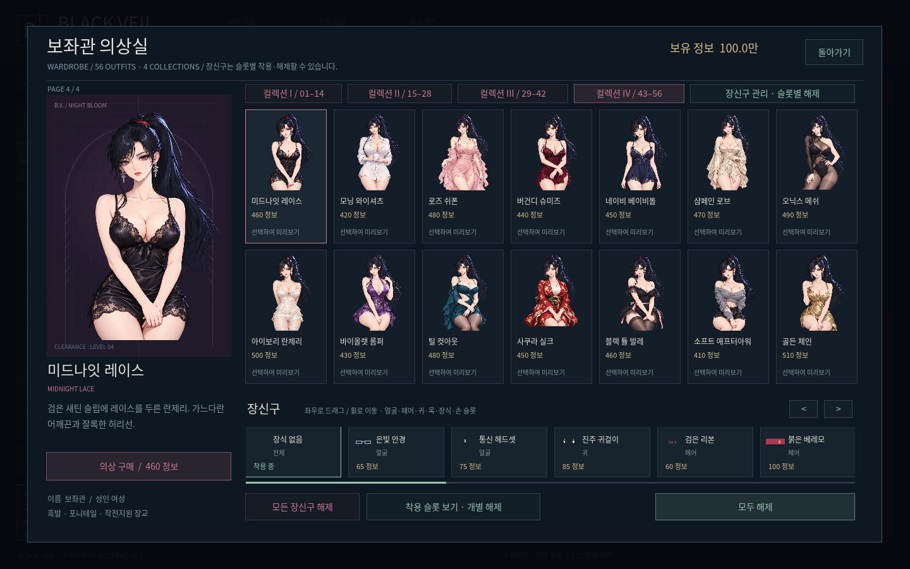
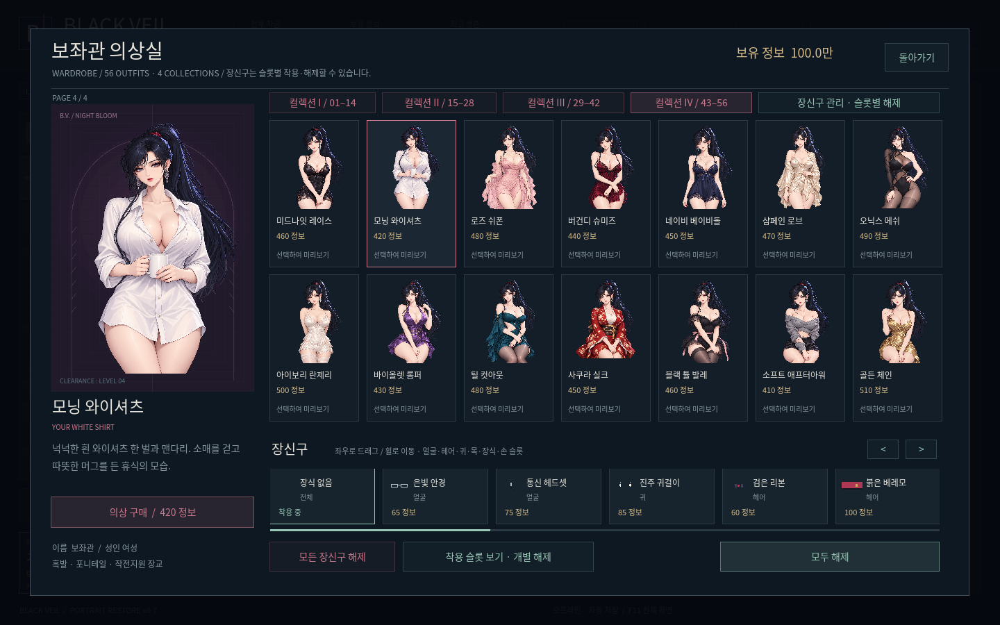
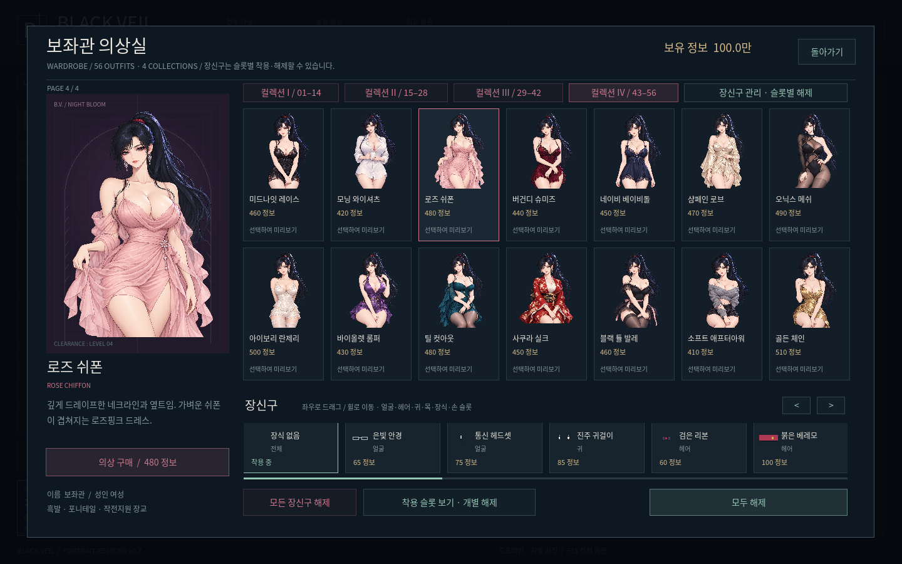
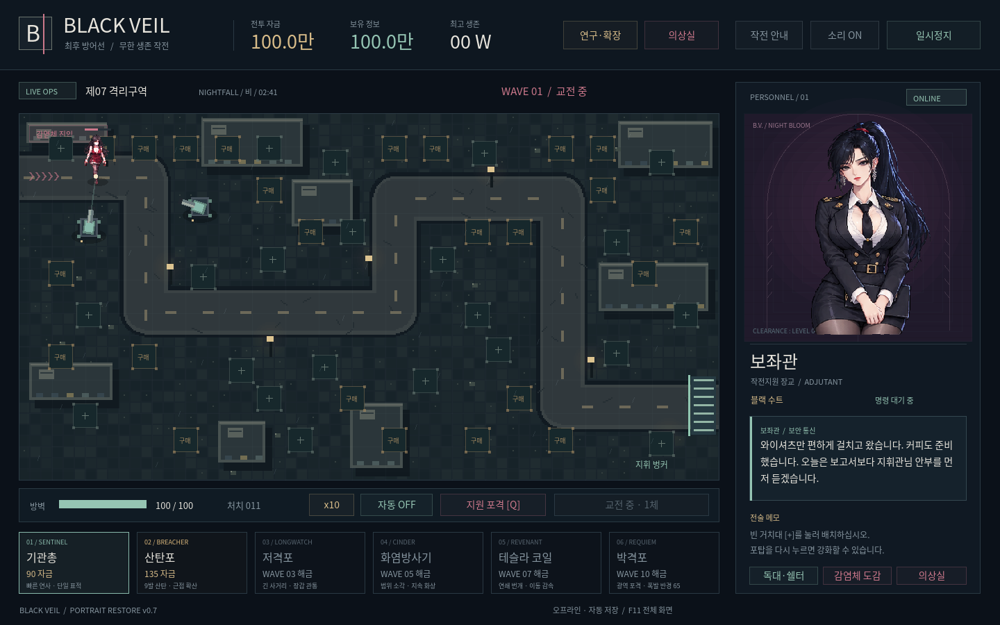

# BLACK VEIL v0.7 · PORTRAIT RESTORE

**[Windows ZIP 직접 다운로드](https://github.com/selecter1302-cloud/-/raw/refs/heads/blackveil-download-v0.7.0/BlackVeil-Windows.zip)**

압축을 풀고 `BlackVeil.exe`를 실행하세요. Windows 10/11 x64용 오프라인 싱글 플레이 게임입니다. 기존 저장은 `%APPDATA%\BlackVeil\black_veil.json`에서 이어갑니다.

- 기본 정장은 최초 보좌관 얼굴 원본으로 복원했습니다.
- 144×192 축소·확대와 런타임 격자 자르기를 제거했습니다. 개별 PNG 56개로 얼굴 디테일을 유지합니다.
- 옆 인물 조각을 제거하고, 포니테일 위 여백·얼굴 중앙 정렬·화면 전체 맞춤을 수정했습니다.
- 얼굴을 교체하던 깜박임을 제거했습니다. 현재는 원본 얼굴 고정입니다.
- 컬렉션 IV에 새 의상 14벌을 추가했습니다. 란제리·와이셔츠·쉬폰·로브·메쉬·실크 기모노 등이며 첫 독대 반응도 추가했습니다.
- 버튼과 F로 1·2·3·4·5·10배속을 선택합니다.
- 기존 무한 강화·24종 연구·배치칸 확장·가격 설정·관계·장신구·쉘터를 유지합니다.

[19초 실제 게임 미리보기](https://github.com/selecter1302-cloud/-/raw/refs/heads/blackveil-download-v0.7.0/preview/Advisor-Preview-v0.7.mp4) · [56벌 개별 실제 화면](preview/portraits)

원화·여백·중앙 정렬·혼입·얼굴 고정과 실제 게임 조작을 검사했습니다. 최종 Windows EXE의 내장 게임도 Linux Godot에서 별도로 검증했습니다. Windows 실기기 실행은 이 환경에서 미확인입니다.

[변경 상세·성장 설계·저장 호환](REDEVELOPMENT.md) · [SHA-256](SHA256SUMS.txt)
